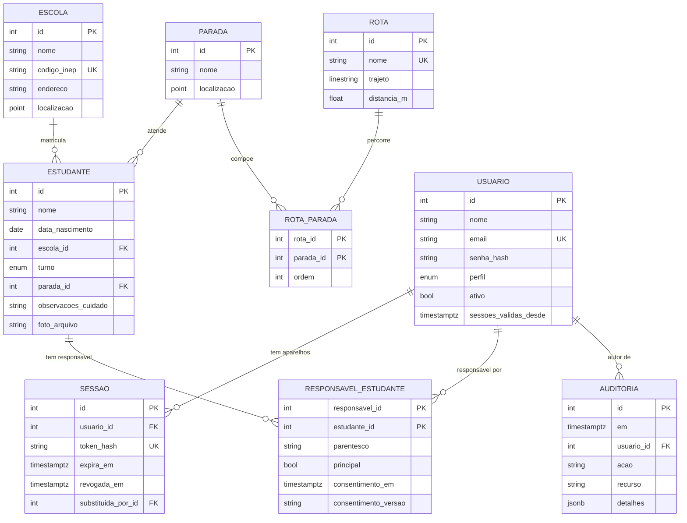

# Modelo de dados

Definido em `backend/app/models.py`. Geometrias usam SRID 4326 (WGS 84), com índice GiST. Este é o estado depois da etapa A da reformulação (ver `docs/reformulacao/README.md`); as tabelas de viagem, embarque e posição entram nas etapas B a D.

## Perfis

`admin`, `gestor`, `motorista`, `monitor` e `responsavel`. Só `admin` e `gestor` são internos (`PERFIS_INTERNOS`) e enxergam os cadastros. Os demais acessam apenas o que um vínculo libera (filho, viagem escalada).

## Decisões

- **Distâncias em metros** são calculadas convertendo para `geography`, porque a geometria em SRID 4326 mede em graus.
- **Trajeto da rota** é a linha reta entre as paradas, na ordem cadastrada. Não segue as ruas: isso exigiria um serviço de roteamento.
- **Acesso por vínculo.** O perfil diz o que a pessoa é; o vínculo diz quais crianças ela pode ver. O responsável só vê o filho depois de registrar o consentimento (LGPD, art. 14).
- **Sessões por aparelho.** O refresh token é guardado só como hash e troca a cada uso; reuso de um token já trocado revoga todas as sessões da pessoa.
- **Auditoria só de inclusão,** sem senha nem token.
- **Dados pessoais mínimos.** Os estudantes são menores de idade: não há CPF nem endereço ou localização da casa (a parada basta), e o responsável é um usuário vinculado, não um nome em texto.
- **Foto fora do JSON.** O arquivo é reencodado (sem EXIF/GPS), guardado com nome aleatório e servido por URL assinada que vale 5 minutos. Só o gestor envia.
- **Observações de cuidado** (alergia, necessidade especial) saem só para administrador e gestor; a equipe da viagem passa a vê-las na etapa C.
- **Removidos na etapa A:** polos, turmas, professores, matrículas, transferências e frequência, e os perfis `diretor` e `coordenador`.
