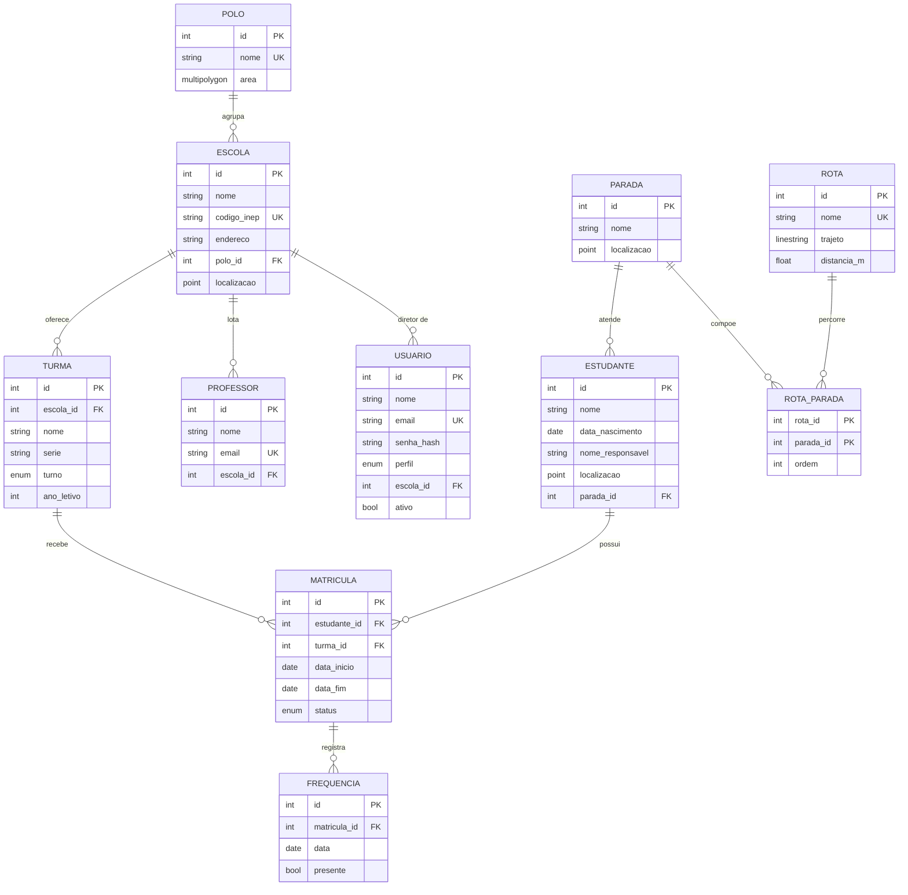

# Modelo de dados

Definido em `backend/app/models.py`. Geometrias usam SRID 4326 (WGS 84), com índice GiST.

## Decisões

- **Matrícula guarda o histórico.** Transferir encerra o vínculo atual (`transferida`) e cria outro. Um índice único parcial impede dois vínculos ativos para o mesmo estudante.
- **Frequência é por matrícula e por dia,** com um registro único para cada par. Assim a falta fica ligada à turma e à escola em que o estudante estava naquele dia.
- **Polo tem área opcional.** O vínculo da escola é por `polo_id`; a área permite consultas espaciais como `ST_Contains`.
- **Distâncias em metros** são calculadas convertendo para `geography`, porque a geometria em SRID 4326 mede em graus.
- **Trajeto da rota** é a linha reta entre as paradas, na ordem cadastrada. Não segue as ruas: isso exigiria um serviço de roteamento, fora do escopo atual.
- **Dados pessoais mínimos.** Os estudantes são, em geral, menores de idade, por isso não há CPF, e a localização da residência é opcional.
- **Fora do escopo:** merenda, estoque e US02, conforme o quadro.
